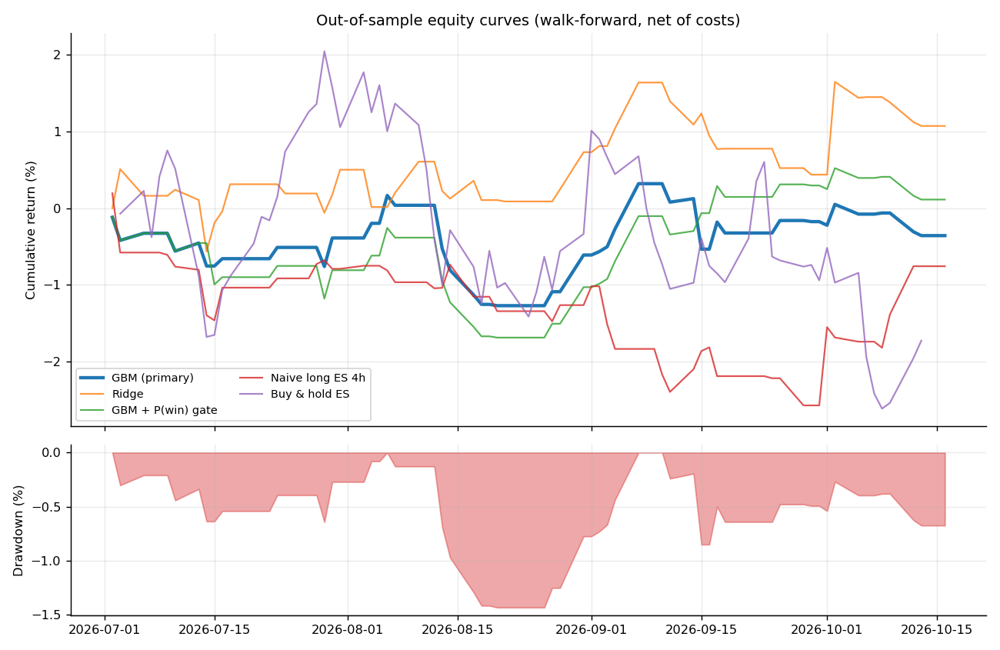
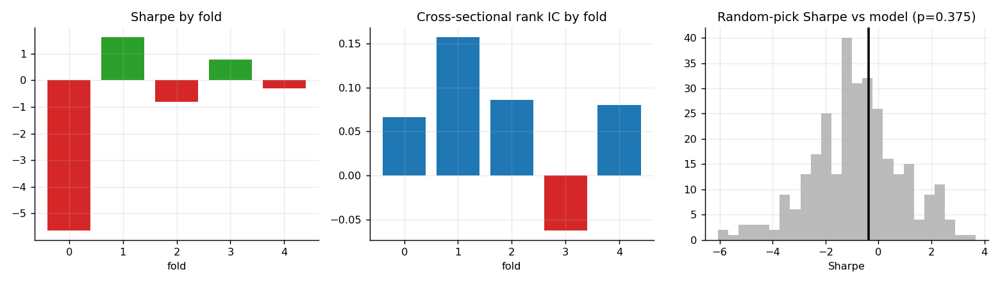
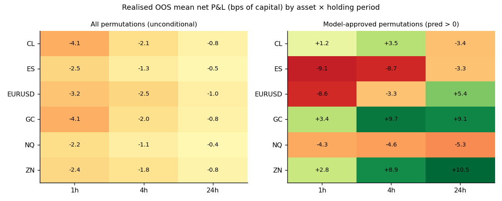
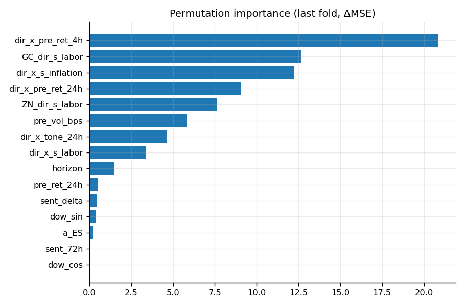
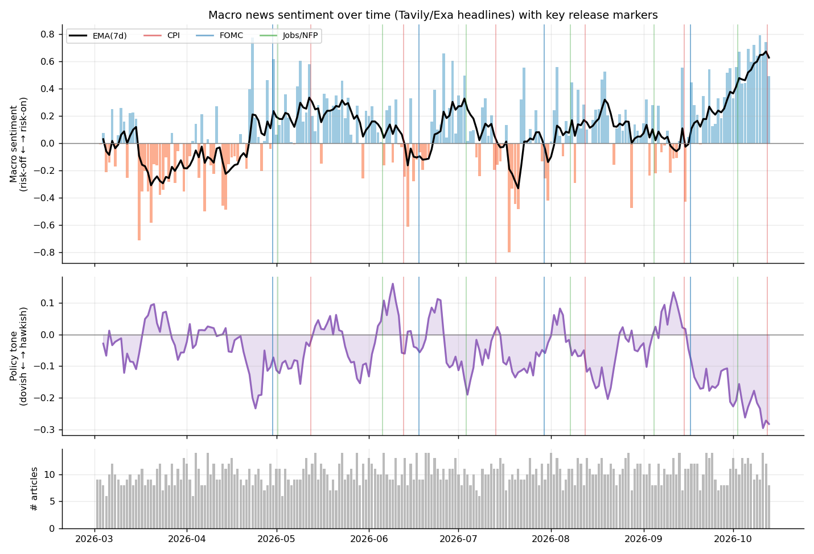
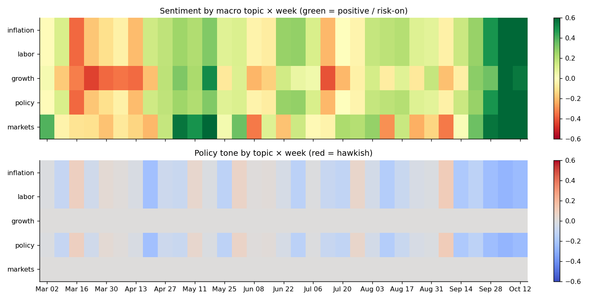
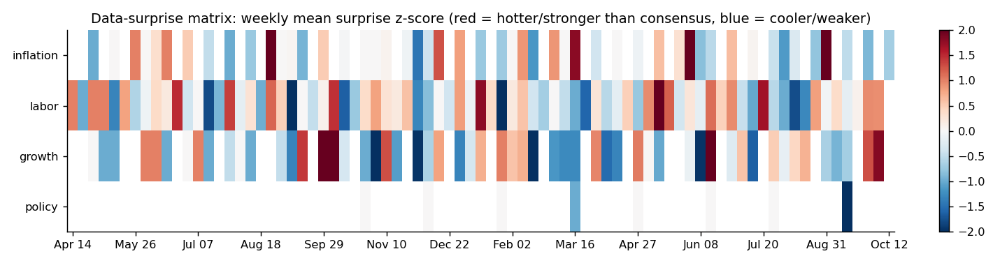
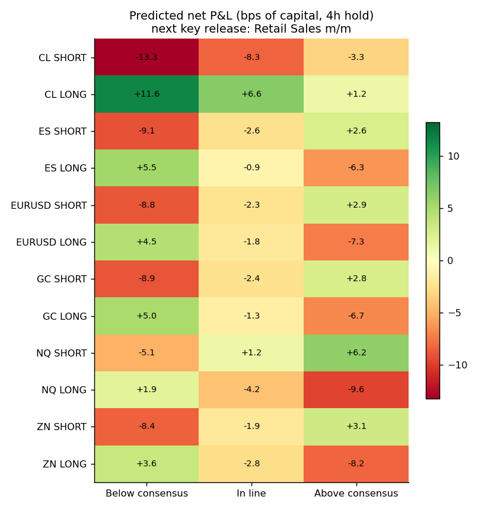

# Evaluation Report — Macro Event Strategy Predictor

> ⚠️ **SYNTHETIC DEMO RUN.** Calendar, news and prices in this report were *generated* by `macro.ingest.synthetic` to exercise the pipeline offline. Results demonstrate the machinery, **not** real market performance. Re-run with `python -m macro live`.

**Data mode:** `demo` · **Generated:** 2026-10-13 18:27 UTC · **OOS window:** 2026-07-02 → 2026-10-13

## 1. Data & provenance
| Dataset | Rows | Source |
|---|---:|---|
| Macro events (USD, medium/high impact; incl. 365d warm-up for surprise normalisation) | 334 | Apify `xtracto/forexfactory-calendar` |
| Release slots traded (one per release timestamp) | 74 | derived |
| News articles (exact-timestamp only used as features) | 2451 (2329 exact) | Tavily |
| Hourly price bars (6 assets) | 23298 | yfinance |

Apify runs:
- (synthetic mode: no Apify run)

## 2. Problem definition
* **Decision unit:** each release timestamp (CPI m/m + Core CPI + CPI y/y at 08:30 ET is *one* slot).
* **Strategy permutations per slot:** 6 assets × 2 directions × 3 horizons ([1, 4, 24] h) = **36**.
* **Entry:** open of the first hourly bar starting ≥ release + 1 min (conservative: no fill inside the release bar). **Exit:** open of the bar `h` bars later.
* **Target:** net P&L in bps of capital, volatility-scaled so a 1σ move over the hold = 25 bps (leverage cap 4.0×), after per-asset round-trip costs. Also a binary win label (P&L>0).
* **Selection rule:** per release, trade the permutation with the highest predicted net P&L if it is > 0.0 bps (one trade per release).

## 3. Validation protocol
* **Expanding-window walk-forward** over release slots, 5 test folds, first 40% of slots used only for initial training.
* **Purge + embargo:** training rows must have *exited* ≥ 24 h before the first test entry (no label overlap).
* **No tuning on test:** hyper-parameters are fixed in `config.yaml`; the primary model (`gbm`) was named *before* looking at results. Ridge / gated variants are reported as ablations, not picked ex-post.
* Surprise z-scores use only *earlier* releases of the same series; news features use only articles with an exact timestamp strictly before the release.

| Fold | Test start | Test end | Train rows | Test rows |
|---|---:|---:|---:|---:|
| 0 | 2026-07-02 | 2026-07-16 | 1008 | 324 |
| 1 | 2026-07-23 | 2026-08-12 | 1368 | 324 |
| 2 | 2026-08-13 | 2026-09-03 | 1656 | 324 |
| 3 | 2026-09-03 | 2026-09-17 | 1968 | 324 |
| 4 | 2026-09-24 | 2026-10-12 | 2340 | 324 |

## 4. Results (out-of-sample, net of costs)
| Strategy | Sharpe | Sortino | Max DD | Ann. return | Calmar | Trades | Win rate | Profit factor |
|---|---:|---:|---:|---:|---:|---:|---:|---:|
| GBM regressor (PRIMARY, pre-specified) | -0.38 | -0.52 | -1.4% | -1.2% | -0.81 | 45 | 49% | 0.92 |
| Ridge (linear baseline) | 0.91 | 1.58 | -1.2% | 3.6% | 3.00 | 45 | 51% | 1.23 |
| GBM + P(win)≥0.5 gate | 0.14 | 0.20 | -1.6% | 0.4% | 0.23 | 45 | 51% | 1.03 |
| Naive: long ES 4h on every release | -0.63 | -0.92 | -2.8% | -2.5% | -0.89 | 45 | 44% | 0.86 |
| Buy & hold ES (benchmark) | -0.68 | -0.92 | -4.6% | -5.8% | -1.28 | 1 | — | — |

* Primary Sharpe 95% block-bootstrap CI: **[-4.36, 3.45]**.
* Random-pick baseline (same slots, random permutation, 300 draws): mean Sharpe **-0.84**; permutation p-value of the primary strategy: **0.375**.
* Sharpe/Sortino are annualised from **daily** returns (√252) on *all* business days in the OOS window (flat days included), Sortino uses downside deviation vs 0, Max DD is on the compounded equity curve.



### Per-fold stability
| Fold | Trades | Sharpe | Return | Rank IC |
|---|---:|---:|---:|---:|
| 0 | 9 | -5.63 | -0.66% | +0.066 |
| 1 | 9 | 1.61 | 0.32% | +0.157 |
| 2 | 9 | -0.81 | -0.16% | +0.086 |
| 3 | 9 | 0.77 | 0.18% | -0.062 |
| 4 | 9 | -0.29 | -0.03% | +0.080 |



### Predictive quality
| Model | Mean rank IC | IC t-stat | IC>0 share | Pooled corr | OOS R² |
|---|---:|---:|---:|---:|---:|
| ridge | +0.077 | 1.63 | 56% | +0.173 | +0.0033 |
| gbm | +0.065 | 1.33 | 58% | +0.074 | -0.0376 |

Classifier (P(win)): AUC **0.533**, base win rate 47.2%, win rate in top decile of P(win) 51.2%.



### Feature importance


Top drivers: `dir_x_pre_ret_4h`, `GC_dir_s_labor`, `dir_x_s_inflation`, `dir_x_pre_ret_24h`, `ZN_dir_s_labor`, `pre_vol_bps`.

## 5. Visual matrix outputs





## 6. Leakage & robustness checklist
- [x] Entry strictly after release timestamp; labels use only later bars.
- [x] Surprise normalisation is expanding/causal; scheduled-calendar features (time-to-next release) are public information.
- [x] Purged/embargoed walk-forward; training labels fully realised before test start.
- [x] Test suite (`pytest`) checks feature immutability under future-data perturbation, fold purge integrity and metric formulas.
- [x] Costs included; vol-scaled sizing uses trailing bars only.

## 7. Limitations (read before trusting any number)
* Small sample: 74 releases in ~180 days. Per-fold Sharpe is noisy; the permutation test and bootstrap CI matter more than the point estimate.
* 36 permutations per release invites selection effects; the walk-forward + fixed hyper-parameters limit but do not remove this.
* Lexicon sentiment is crude; Tavily results are search-ranked (not a complete news archive) and undated items are excluded from features.
* Simple cost model (fixed bps), no slippage/market impact, futures roll/gaps ignored, hourly bars only.
* Only USD macro releases; regime shifts (e.g. policy pivots) can break learned relationships.

## 8. Reproduce
```bash
pip install -e . && cp .env.example .env   # add APIFY_TOKEN, TAVILY_API_KEY
python -m macro live      # ingest → features → walk-forward → charts → reports
pytest -q
```
