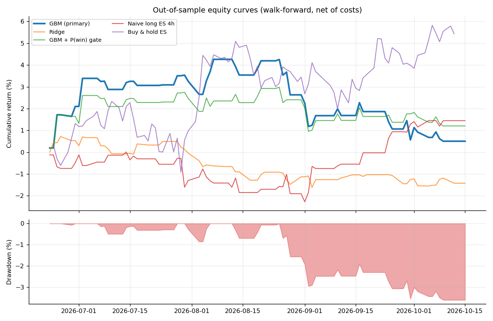
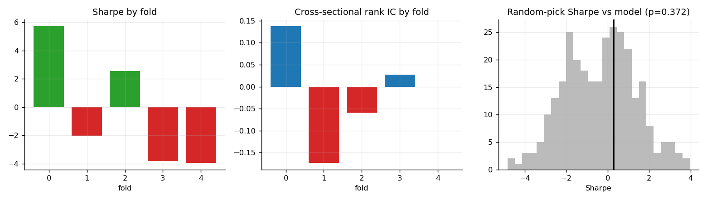
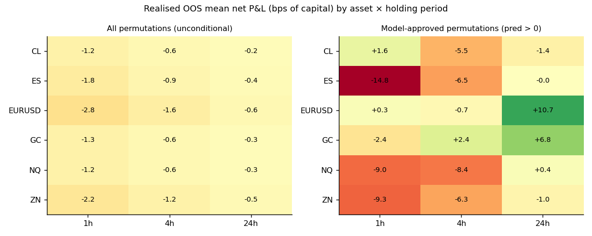
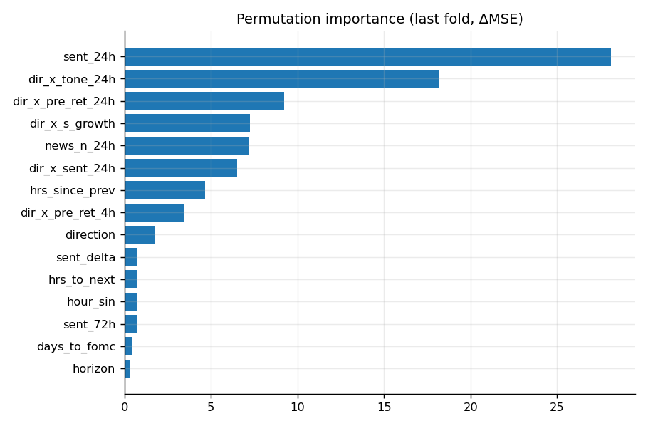
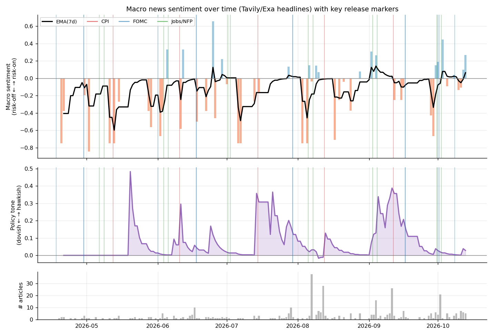
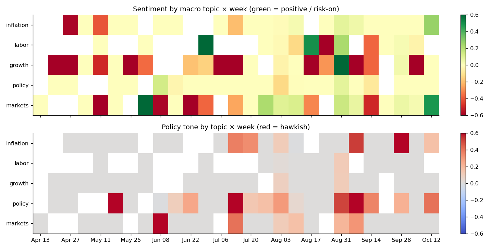
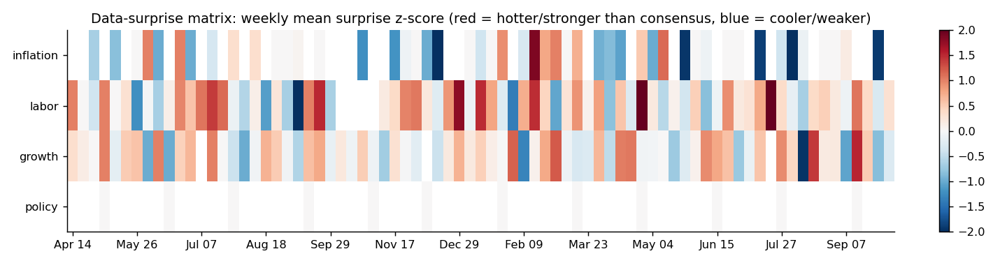
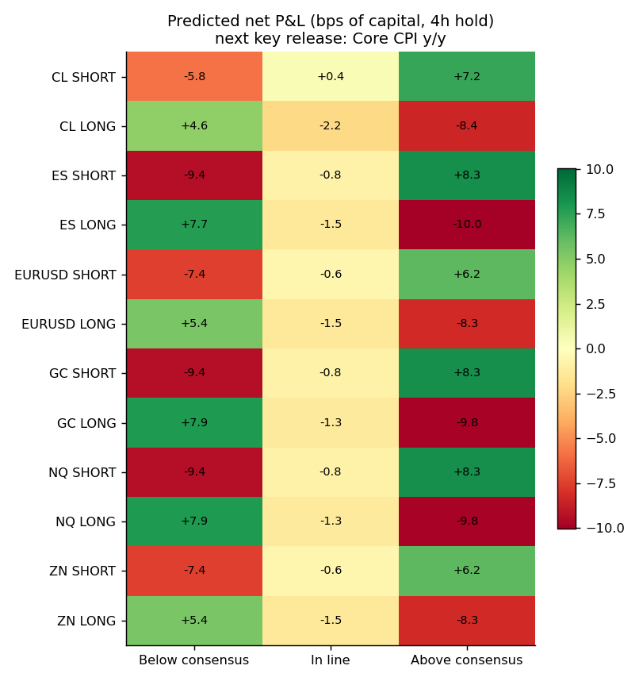

# Evaluation Report — Macro Event Strategy Predictor

**Data mode:** `live` · **Generated:** 2026-10-13 19:52 UTC · **OOS window:** 2026-06-23 → 2026-10-12

## 1. Data & provenance
| Dataset | Rows | Source |
|---|---:|---|
| Macro events (USD, medium/high impact; incl. 365d warm-up for surprise normalisation) | 830 | Apify `xtracto/forexfactory-calendar` |
| Release slots traded (one per release timestamp) | 109 | derived |
| News articles (exact-timestamp only used as features) | 394 (394 exact) | Tavily |
| Hourly price bars (6 assets) | 21858 | yfinance |

Apify runs:
- `xtracto/forexfactory-calendar` run `UaUkgc1OdoQWbMJgi` dataset `owrf4emcuTVMyXphA` (2025-04-16 → 2025-06-14, 96 rows)
- `xtracto/forexfactory-calendar` run `q0MH2er7GVaZdAuKA` dataset `Bo3aCkyTIzjKi15lk` (2025-06-15 → 2025-08-13, 93 rows)
- `xtracto/forexfactory-calendar` run `v4rtnTvuQK2PAWWDn` dataset `p8dADstYnf6p0f9P1` (2025-08-14 → 2025-10-12, 92 rows)
- `xtracto/forexfactory-calendar` run `o0eSeaVhLatujo2oQ` dataset `P8JYbh6lod2L1f7vo` (2025-10-13 → 2025-12-11, 80 rows)
- `xtracto/forexfactory-calendar` run `3bpwAOEwdMxdxZKnb` dataset `reA8Mk5k4rLv93rMd` (2025-12-12 → 2026-02-09, 94 rows)
- `xtracto/forexfactory-calendar` run `JPBOqhV6AVqX9NeTY` dataset `0aa9Xx8Al5IivAUL3` (2026-02-10 → 2026-04-10, 110 rows)
- `xtracto/forexfactory-calendar` run `ny3M3evwApaScwcFx` dataset `Ap8T9hlXMFUNCjbvW` (2026-04-11 → 2026-06-09, 82 rows)
- `xtracto/forexfactory-calendar` run `c78WCBL3aISWlWRn2` dataset `mDFSQebWqLc6Xh6uK` (2026-06-10 → 2026-08-08, 83 rows)
- `xtracto/forexfactory-calendar` run `87WZchmQoDznIj5Rh` dataset `fsnqgPDdnScPsaUkb` (2026-08-09 → 2026-10-07, 78 rows)
- `xtracto/forexfactory-calendar` run `34t7TEldwuDeaEIEX` dataset `285JDgVa1Z7ncf24E` (2026-10-08 → 2026-10-27, 22 rows)

## 2. Problem definition
* **Decision unit:** each release timestamp (CPI m/m + Core CPI + CPI y/y at 08:30 ET is *one* slot).
* **Strategy permutations per slot:** 6 assets × 2 directions × 3 horizons ([1, 4, 24] h) = **36**.
* **Entry:** open of the first hourly bar starting ≥ release + 1 min (conservative: no fill inside the release bar). **Exit:** open of the bar `h` bars later.
* **Target:** net P&L in bps of capital, volatility-scaled so a 1σ move over the hold = 25 bps (leverage cap 4.0×), after per-asset round-trip costs. Also a binary win label (P&L>0).
* **Selection rule:** per release, trade the permutation with the highest predicted net P&L if it is > 0.0 bps (one trade per release).

## 3. Validation protocol
* **Expanding-window walk-forward** over release slots, 5 test folds, first 40% of slots used only for initial training.
* **Purge + embargo:** training rows must have *exited* ≥ 24 h before the first test entry (no label overlap).
* **No tuning on test:** hyper-parameters are fixed in `config.yaml`; the primary model (`gbm`) was named *before* looking at results. Ridge / gated variants are reported as ablations, not picked ex-post.
* Surprise z-scores use only *earlier* releases of the same series; news features use only articles with an exact timestamp strictly before the release.

| Fold | Test start | Test end | Train rows | Test rows |
|---|---:|---:|---:|---:|
| 0 | 2026-06-23 | 2026-07-14 | 1526 | 458 |
| 1 | 2026-07-15 | 2026-08-04 | 1912 | 468 |
| 2 | 2026-08-05 | 2026-08-27 | 2404 | 468 |
| 3 | 2026-08-28 | 2026-09-17 | 2896 | 458 |
| 4 | 2026-09-24 | 2026-10-09 | 3378 | 504 |

## 4. Results (out-of-sample, net of costs)
| Strategy | Sharpe | Sortino | Max DD | Ann. return | Calmar | Trades | Win rate | Profit factor |
|---|---:|---:|---:|---:|---:|---:|---:|---:|
| GBM regressor (PRIMARY, pre-specified) | 0.28 | 0.43 | -3.6% | 1.5% | 0.43 | 65 | 54% | 1.06 |
| Ridge (linear baseline) | -1.49 | -1.98 | -2.3% | -4.3% | -1.84 | 66 | 44% | 0.78 |
| GBM + P(win)≥0.5 gate | 0.72 | 1.21 | -2.0% | 3.7% | 1.89 | 60 | 57% | 1.17 |
| Naive: long ES 4h on every release | 0.89 | 1.24 | -2.3% | 4.5% | 1.95 | 66 | 52% | 1.19 |
| Buy & hold ES (benchmark) | 1.55 | 2.49 | -3.2% | 15.4% | 4.85 | 1 | — | — |

* Primary Sharpe 95% block-bootstrap CI: **[-3.80, 3.70]**.
* Random-pick baseline (same slots, random permutation, 300 draws): mean Sharpe **-0.36**; permutation p-value of the primary strategy: **0.372**.
* Sharpe/Sortino are annualised from **daily** returns (√252) on *all* business days in the OOS window (flat days included), Sortino uses downside deviation vs 0, Max DD is on the compounded equity curve.



### Per-fold stability
| Fold | Trades | Sharpe | Return | Rank IC |
|---|---:|---:|---:|---:|
| 0 | 13 | 5.71 | 3.19% | +0.137 |
| 1 | 13 | -2.06 | -0.44% | -0.173 |
| 2 | 12 | 2.55 | 0.91% | -0.059 |
| 3 | 13 | -3.81 | -1.74% | +0.027 |
| 4 | 14 | -3.94 | -1.33% | -0.000 |



### Predictive quality
| Model | Mean rank IC | IC t-stat | IC>0 share | Pooled corr | OOS R² |
|---|---:|---:|---:|---:|---:|
| ridge | -0.062 | -1.36 | 39% | +0.007 | -0.0720 |
| gbm | -0.013 | -0.33 | 50% | +0.021 | -0.0626 |

Classifier (P(win)): AUC **0.489**, base win rate 48.4%, win rate in top decile of P(win) 50.4%.



### Feature importance


Top drivers: `sent_24h`, `dir_x_tone_24h`, `dir_x_pre_ret_24h`, `dir_x_s_growth`, `news_n_24h`, `dir_x_sent_24h`.

## 5. Visual matrix outputs





## 6. Leakage & robustness checklist
- [x] Entry strictly after release timestamp; labels use only later bars.
- [x] Surprise normalisation is expanding/causal; scheduled-calendar features (time-to-next release) are public information.
- [x] Purged/embargoed walk-forward; training labels fully realised before test start.
- [x] Test suite (`pytest`) checks feature immutability under future-data perturbation, fold purge integrity and metric formulas.
- [x] Costs included; vol-scaled sizing uses trailing bars only.

## 7. Limitations (read before trusting any number)
* Small sample: 109 releases in ~180 days. Per-fold Sharpe is noisy; the permutation test and bootstrap CI matter more than the point estimate.
* 36 permutations per release invites selection effects; the walk-forward + fixed hyper-parameters limit but do not remove this.
* Lexicon sentiment is crude; Tavily results are search-ranked (not a complete news archive) and undated items are excluded from features.
* Simple cost model (fixed bps), no slippage/market impact, futures roll/gaps ignored, hourly bars only.
* Only USD macro releases; regime shifts (e.g. policy pivots) can break learned relationships.

## 8. Reproduce
```bash
pip install -e . && cp .env.example .env   # add APIFY_TOKEN, TAVILY_API_KEY
python -m macro live      # ingest → features → walk-forward → charts → reports
pytest -q
```
